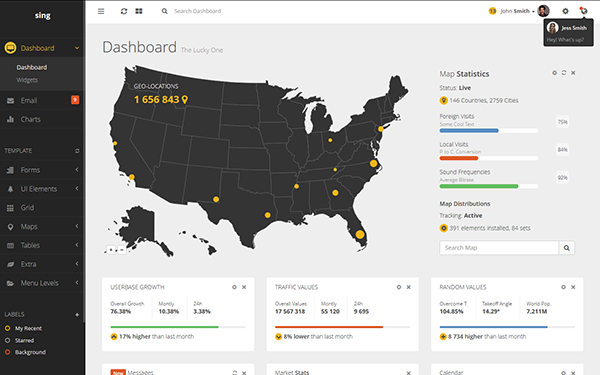

# Sing App Angular

Sing App is a free Angular dashboard with a responsive Bootstrap layout. Open the Analytics and Visits dashboards, filter data grids, edit forms, browse a product catalog and navigate a calendar. The standalone demo ships with sample data. API mode connects the same interface to a backend.

[Live demo](https://flatlogic.com/templates/sing-app-angular/demo) · [Latest release](https://github.com/flatlogic/sing-app-angular/releases/latest) · [Changelog](changelog.md)



## Start the standalone demo

Use Node.js 22.13 or later on the 22.x line, or Node.js 24 LTS, with npm 10 or later.

```sh
git clone https://github.com/flatlogic/sing-app-angular.git
cd sing-app-angular
npm ci
npm start
```

Open [localhost:3000](http://localhost:3000/) and click **Login** with the prefilled credentials. Sample data is bundled with the frontend. The browser remembers the demo session until you log out. Persistent changes to products require API mode.

| Command | Result |
| --- | --- |
| `npm run build:demo` | Build the sample dashboard for static hosting |
| `npm run start:backend` | Run the development frontend against an API |
| `npm run build` | Build the production frontend with API sign-in |
| `npm test` | Run the session tests |
| `npm run lint` | Check TypeScript with ESLint |

Both production builds write deployable files to `dist/`. Serve the contents of that directory over HTTP. Relative asset URLs and hash-based routes allow deployment beneath a subdirectory.

## Connect a backend

Run the [Flatlogic Node.js backend](https://github.com/flatlogic/nodejs-backend) and use an account registered with that API. The development frontend expects `http://localhost:8080/api`. The production frontend uses `/api` on its own origin. To change this without rebuilding, set the content of the `sing-api` meta tag in the deployed `index.html`. For a separate API origin, allow the frontend origin on the API.

The default sign-in and registration endpoints are `/auth/signin/local` and `/auth/signup`, relative to the API base. For older servers using `/user`, change `authPath` in [app.config.ts](src/app/app.config.ts) before building. Google and Microsoft sign-in require the corresponding provider configuration on your backend.

## Upgrade from 5.x

Use npm with the committed lockfile. Version 6 uses Angular 21 LTS and the Angular application builder. Choose `build:demo` for the sample site and `build` for API deployments. The new lockfile replaces the old Yarn and Napa setup.

## Project layout

| Directory | Contents |
| --- | --- |
| `src/app/pages/` | Dashboards, charts, tables, forms, maps, calendar and ecommerce screens |
| `src/app/layout/` | Application shell, navigation and shared widgets |
| `src/environments/` | Standalone and API build modes |
| `src/vendor/` | Legacy widget sources and their upstream licenses |

[More Flatlogic templates](https://flatlogic.com/templates) · [Report an issue](https://github.com/flatlogic/sing-app-angular/issues) · [MIT license](LICENSE)
